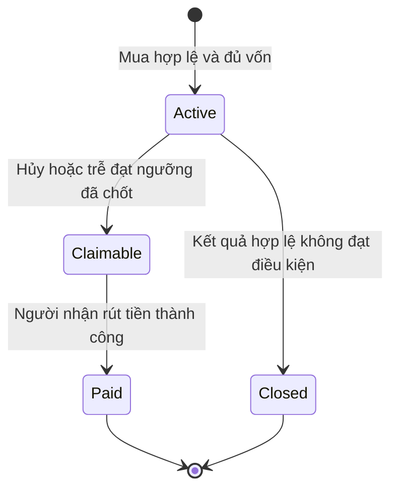

# Kiến trúc và luồng nghiệp vụ đề xuất

Trạng thái tài liệu là thiết kế để thảo luận. Repository hiện có tài liệu và prototype mô phỏng nghiệp vụ bằng Python. Ngưỡng 120 phút và một số điều khoản dưới đây là đề xuất ban đầu, chưa phải quyết định được nhóm/giảng viên duyệt.

## Kiến trúc

```mermaid
%%{init: {"theme":"base", "themeVariables":{"fontFamily":"Arial, sans-serif", "fontSize":"15px", "primaryColor":"#F3F6FA", "primaryTextColor":"#243247", "primaryBorderColor":"#657A95", "lineColor":"#657A95", "secondaryColor":"#FFF1E8", "tertiaryColor":"#EAF1FB"}, "flowchart":{"useMaxWidth":true, "nodeSpacing":35, "rankSpacing":45, "curve":"stepAfter"}}}%%
flowchart LR
    D["Dữ liệu Flight Delays 2015"] --> P["Làm sạch và chia dữ liệu<br/>theo thời gian"]
    P --> G["Đồ thị sân bay<br/>và tuyến bay"]
    P --> B["Baseline và mô hình<br/>xác suất rủi ro"]
    G --> B
    B --> Q["Dịch vụ báo giá<br/>off-chain"]
    Q --> S["Báo giá được ký<br/>bởi bên cung cấp"]

    U["Người dùng<br/>và ví"] --> UI["DApp"]
    S -->|"Báo giá"| UI
    UI -->|"Mua policy"| C["Smart Contract<br/>trên local blockchain"]
    O["Oracle được cấp quyền"] -->|"Kết quả chuyến bay cuối cùng<br/>từ kịch bản demo"| C
    C --> E["Event và<br/>transaction receipt"]
    E --> UI

    classDef data fill:#F3F6FA,stroke:#657A95,color:#243247,stroke-width:1.5px;
    classDef riskFeature fill:#FFF1E8,stroke:#C76435,color:#243247,stroke-width:1.5px;
    classDef app fill:#EAF1FB,stroke:#52749C,color:#243247,stroke-width:1.5px;
    class D,P data;
    class G,B,Q,S riskFeature;
    class U,UI,O,E app;
    class C app;
```

Báo giá dự kiến được ký ngoài chuỗi và xác minh trong contract. Chữ ký ràng buộc chain ID, contract, người mua, flight ID, premium, payout, thời điểm hết hạn và nonce. Oracle và bên ký báo giá là hai quyền riêng, dù có thể do cùng nhóm vận hành trong demo. Việc cấp quyền không chứng minh nguồn dữ liệu hàng không là đúng.

Graph Analytics là hạng mục cần hỏi giảng viên trước khi chốt: phương án gọn đang cân nhắc là airport/route graph với PageRank hoặc degree, sau đó ablation mô hình có/không có graph feature trên cùng temporal split. Chưa mặc định phải làm GNN. Graph chỉ dùng dữ liệu thuộc train/history; không dùng kết quả chuyến bay trong test để tạo feature.

## Luồng người dùng

1. Chọn chuyến bay gồm hãng, số hiệu, ngày bay, sân bay đi và đến.
2. Xem báo giá với premium, payout, ngưỡng trễ, hạn mua và điều khoản hủy.
3. Ví ký giao dịch mua. Contract kiểm tra báo giá, thời hạn, phí và quỹ dự trữ.
4. Sau khi giao dịch được xác nhận, giao diện hiển thị policy và transaction hash.
5. Oracle gửi kết quả chuyến bay đã kết thúc theo kịch bản demo.
6. Một giao dịch giải quyết policy xác định quyền bồi thường hoặc kết thúc không bồi thường.
7. Người nhận rút khoản được ghi có. Giao diện hiển thị trạng thái chờ, thành công hoặc thất bại theo receipt.

## Trạng thái policy

Kết quả chưa cuối cùng, chuyến chuyển hướng và thiếu dữ liệu giữ policy ở trạng thái chờ cho đến khi có quy tắc xử lý đã chốt. Cơ chế timeout/hoàn phí cần được xác định trước khi hoàn thiện contract.

## Vốn và phân quyền

- Admin cấp vốn và quản lý quyền. Mọi khoản rút vốn phải bảo toàn trách nhiệm đã cam kết.
- Oracle gửi kết quả chuyến bay, một kết quả cuối cùng được dùng cho các policy cùng chuyến.
- Người dùng mua policy và rút tiền thuộc quyền của mình.
- Khi mua, tổng số dư quỹ sau thu phí phải ít nhất bằng tổng payout đã dự trữ.
- Khi ghi có bồi thường, khoản dự trữ chuyển thành khoản phải trả và vẫn được bảo toàn cho đến lúc rút thành công.
- Việc giải quyết từng policy được thực hiện bằng giao dịch riêng để tránh vòng lặp không giới hạn.

## Hướng triển khai dự kiến

Hồ sơ đề tài ghi Ethereum/Solidity. Giảng viên khuyến nghị Vyper + Ape + Anvil theo công cụ môn học; nhóm cần kiểm tra khả năng và xác nhận có bắt buộc chuyển stack hay không. Dùng một ngôn ngữ/framework contract duy nhất sau khi chốt. Python cho dữ liệu/AI và graph nếu được yêu cầu; frontend cần hỗ trợ ví ký giao dịch.
